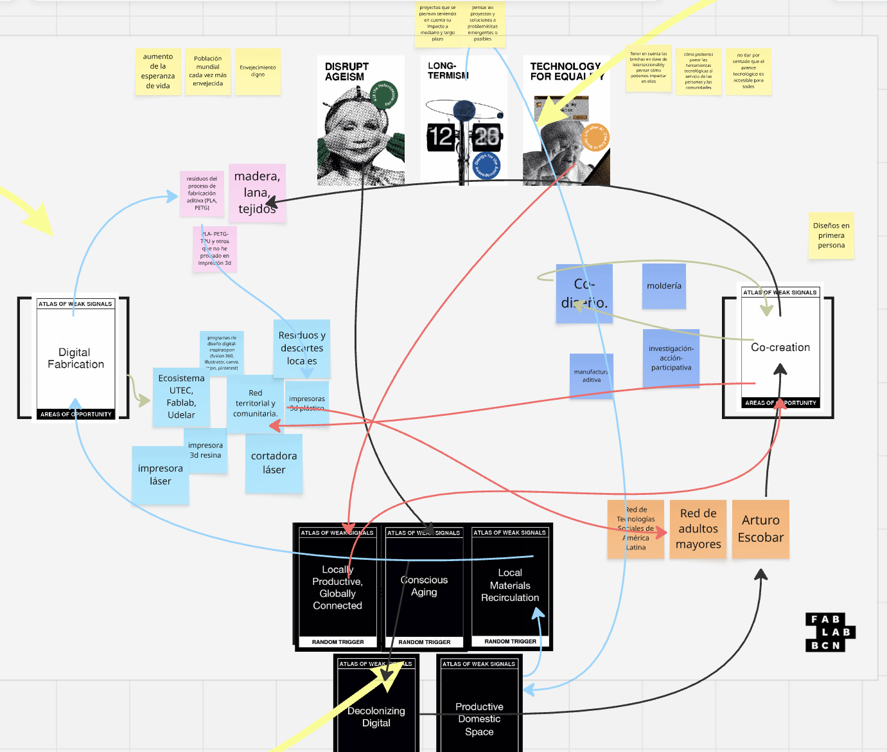
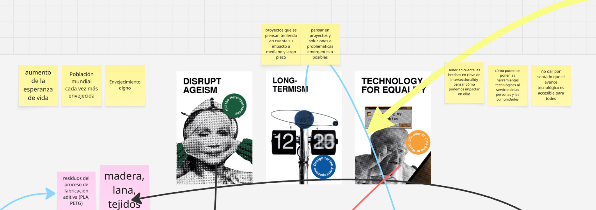
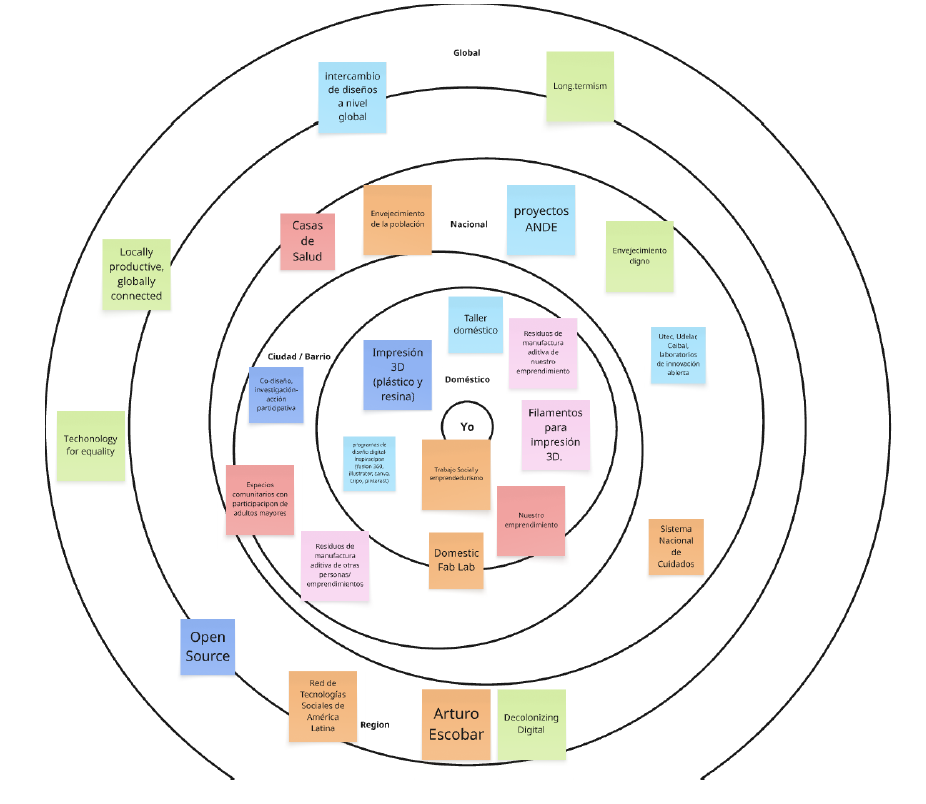
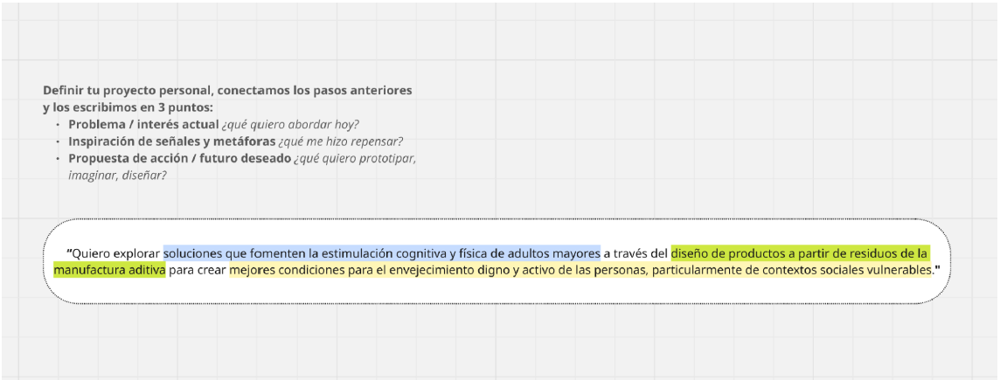

---
hide:
    - toc
---

# MD01

## Ejercicio: Weak Signals

Esta primera captura es de todo el esquema en Miro. Me encantó explorar todas las tarjetas y aprender sobre conceptos y contextos que no había tenido en cuenta o desconocía. Incluso encontré fenómenos sociales que no sabía que tenían un nombre como concepto. Me interesó que muchas tarjetas contemplaran problemáticas sociales que pueden relacionarse desde una perspectiva de derechos. Dediqué bastante tiempo a armar una especie de glosario de conceptos; fue muy interesante, aunque por eso no pude centrarme en la consigna tanto como hubiese querido.

Elegí estas tres tarjetas como *weak signals* porque resuenan con algunas ideas que vengo pensando para el proyecto final y con mis intereses. Al explorar las cartas, sentí que encajaban muy bien entre sí y me permitían abordar varias dimensiones a la vez.

Lo que más me gustó del ejercicio fue que no simplificara los aspectos y desafíos que pueden abordarse desde proyectos de diseño e innovación. Me permitió tomar conciencia de todo lo que se puede poner en juego al pensar una idea. Desde mi experiencia en “lo social”, me resultó muy gratificante ver todo lo que se toma en cuenta, o se puede tomar en cuenta, desde el mundo del diseño. Me sorprendió gratamente descubrir la profundidad con la que se trabajan estos aspectos y me encantó la perspectiva del juego para pensar en el diseño.

## Diseño multiescalar

Luego avancé hacia la consigna de generar un espacio de diseño multiescalar. Este fue el ejercicio que más “me abrió la cabeza”. Siento que me cuesta integrar mi experiencia como Trabajadora Social con la de emprendedora: como emprendedora, suelo estar muy centrada en “pensar en chiquito”, dentro de mi casa, con mis herramientas y habilidades. Me cuesta salir de ese contexto. Parte de mi objetivo al sumarme a esta formación era desafiarme en ese sentido.

El ejercicio me permitió “pensar en grande” sobre las escalas y los contextos donde las cosas se pueden mover, poner a funcionar y hacer dialogar entre sí.

Si bien llegué a una frase final siguiendo el esquema propuesto y a partir de las *weak signals* que más me llamaron la atención, estoy segura de que voy a continuar modificando la herramienta y generando nuevos espacios de diseño a medida que avance en el proceso y me aproxime más a mi idea final.

Me alegro de haber hecho capturas a tiempo: en determinado momento se borró todo mi avance y me quedé solo con algunos comentarios que hice durante la clase en que trabajamos en Miro. Aún no tengo claro qué sucedió. Luego, con ayuda de la profesora, pude resolverlo: el rectángulo de fondo se había pasado adelante y tapaba mi trabajo.
