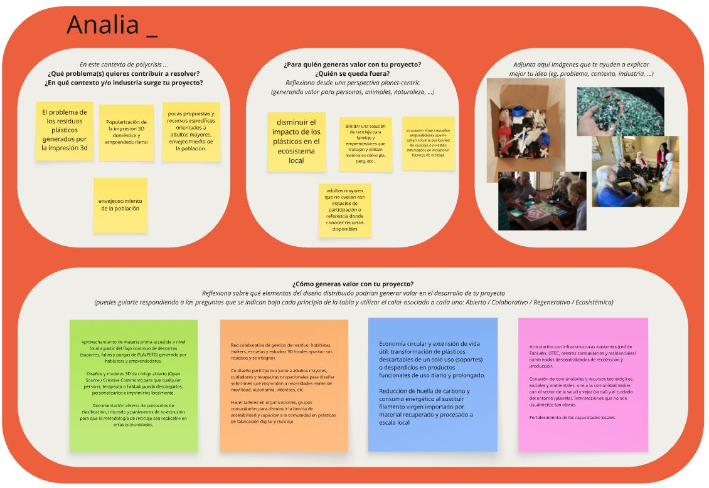
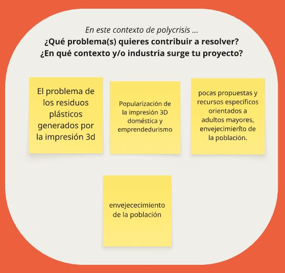
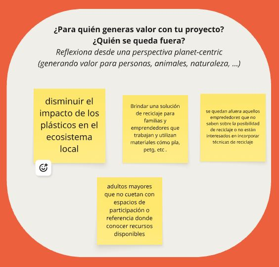
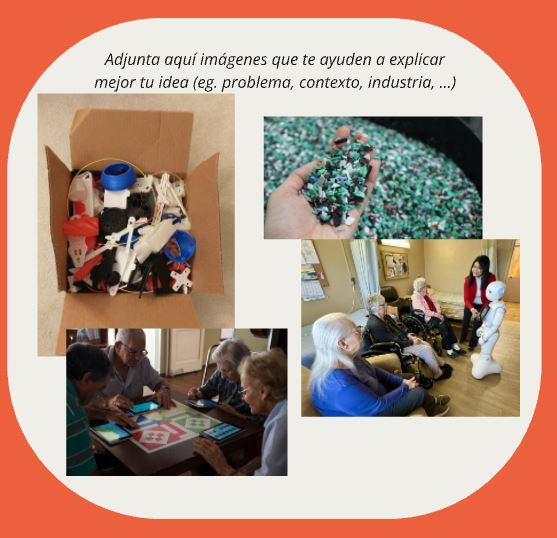
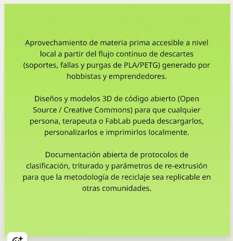
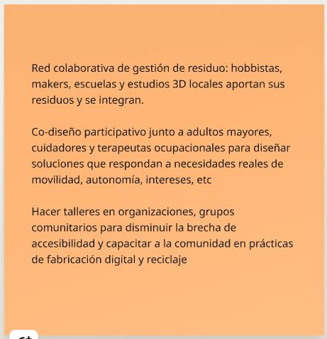
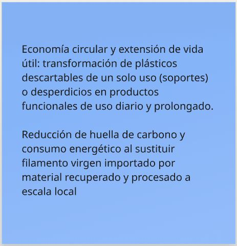
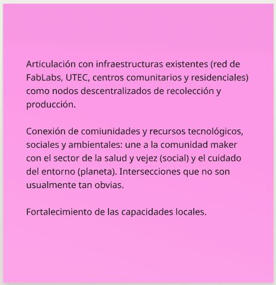

---
hide:
    - toc
---

# MI01

**Eje:** Innovación y Sostenibilidad

## Tarea Miro: diseño distribuido

El ejercicio me ayudó especialmente a cambiar la forma en que pienso en mis ideas y mi emprendimiento, y a seguir ejercitando lo que comenzamos en el ejercicio anterior que hicimos en Miro.

Me ayuda a cambiar el punto de vista de la escala en la que pienso: pasar de estar sola en el taller, con mis ideas y mis recursos, a verme como parte de una red con acceso a otras ideas y recursos comunitarios, nacionales e internacionales.

Otra cosa que noto es cómo estar todo el tiempo escuchando y conociendo ideas y proyectos me activa la capacidad creativa al pensar. No solo en mi emprendimiento o para el proyecto en particular, sino también desde el trabajo social. Si bien estamos en el mundo de la información, internet y la IA, eso por sí solo no construye una comunidad y tampoco te muestra ni te brinda la calidad y cantidad de información que surge de un grupo de personas muy diferentes interesadas en un mismo tema. Me entusiasma mucho.

## Registro visual del ejercicio

