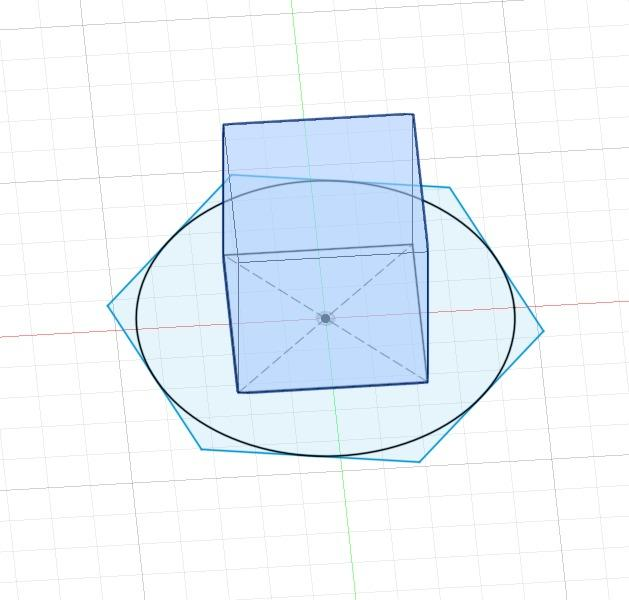
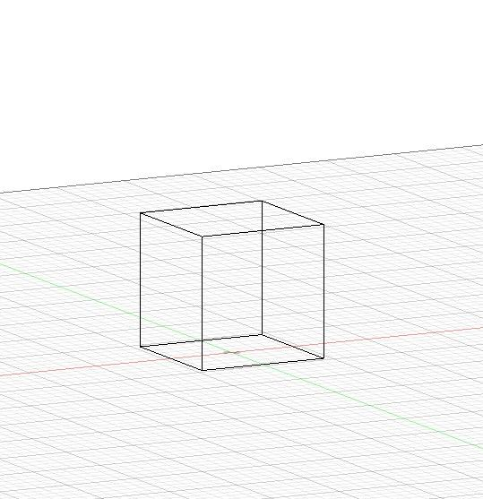
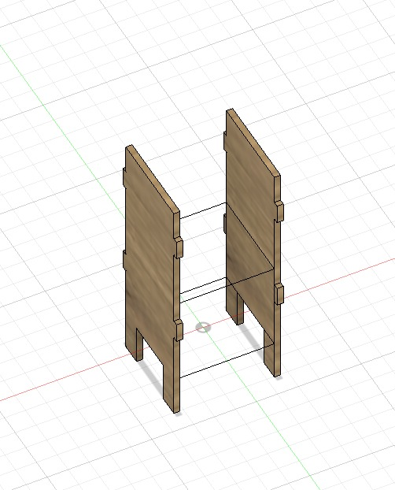
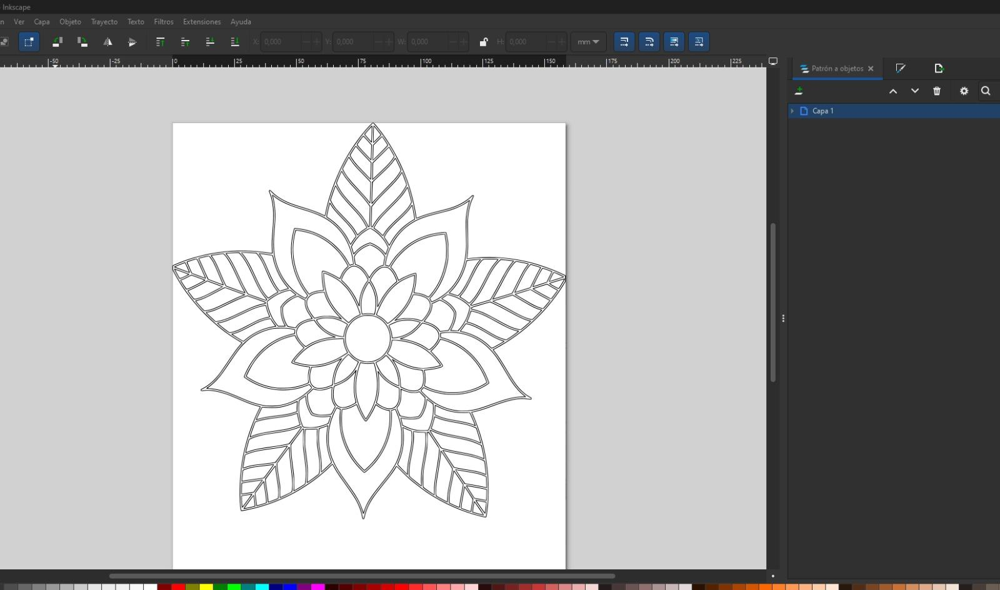
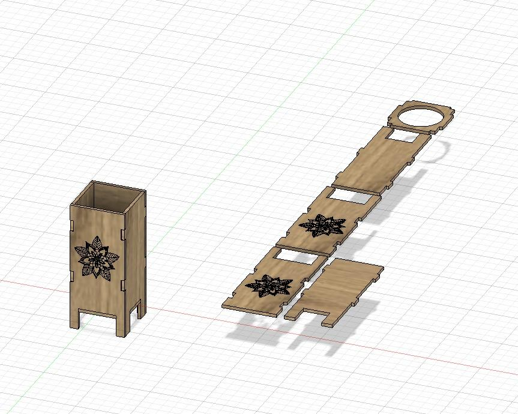
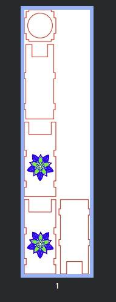
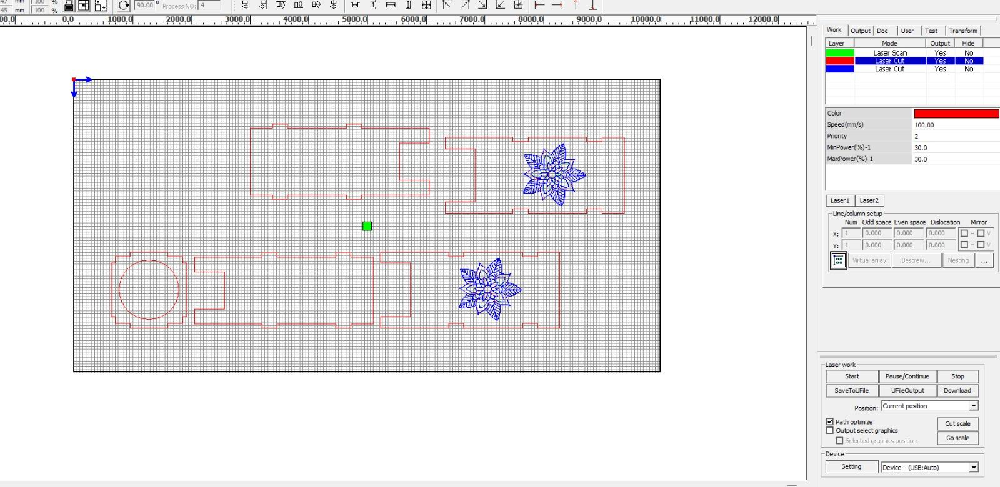
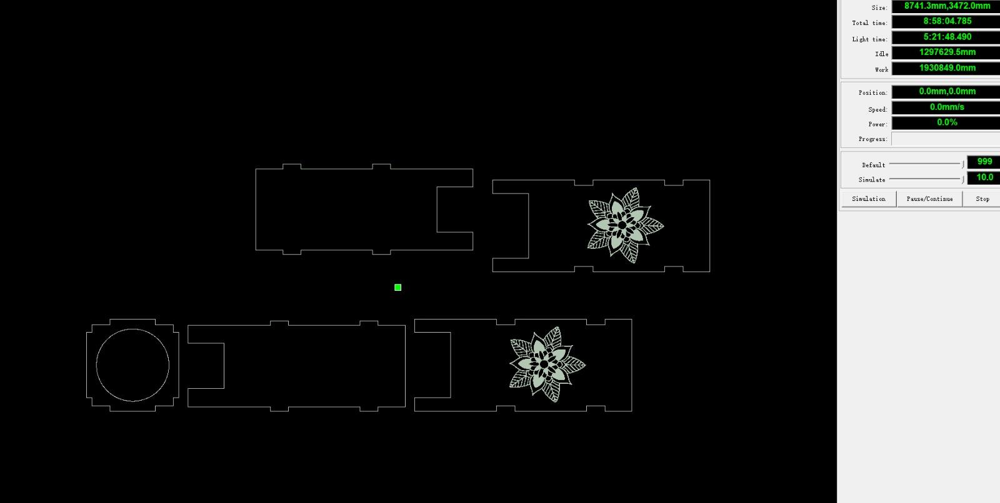

---
hide:
    - toc
---

# MT03

**Eje:** Tecnología y fabricación

## Desarrollo del diseño

Esta vez el diseño fue más fácil que la vez anterior con el proyecto de Memorati.

En principio quería hacer una lámpara hexagonal o triangular (de varias caras), pero los encastres en ese caso eran un desafío para que quedaran bien sin usar pegamento ni nada extra para ensamblar, así que desistí.

Seguí bastante el tutorial de clase para hacer el diseño, sobre todo al empezar, y luego simplifiqué bastante el diseño, modificando especialmente las patas.

Opté por un diseño básico de cuatro caras. Le hice dos solapas porque, al ser bastante alta, me parecía que era mejor y que daba un mejor “agarre”.

## Mandala y preparación del modelo

Usé un mandala porque me gustan mucho y me permitía usar corte y raster para el dibujo. Bajé el diseño de un mandala y lo pasé por Inkscape para hacer el SVG. Llegado el momento de pasar el mandala al diseño en Fusion, me tuve que pasar a la computadora de mi compañero porque mi laptop se trancaba y no lograba procesar los archivos.

El desafío más grande que tuve fue transformar los *bodies* en *components*, proceso que nunca había hecho.

## Preparación del corte láser

Luego pasé el SVG de los componentes por Inkscape para colorearlo de acuerdo al tutorial de clase, para que tuviese correspondencia entre las “operaciones” láser y los colores.

Lo pasé a RDWorks y lo orienté. La asignación de colores me funcionó perfecto para definir las operaciones, así que no tuve que hacer nada extra.

Hice la simulación y todo parecía estar funcionando correctamente. Durante todo este proceso fui haciéndole preguntas y recibí la ayuda de mi compañero Santiago, que ya había hecho su proyecto y tenía experiencia en el proceso.

